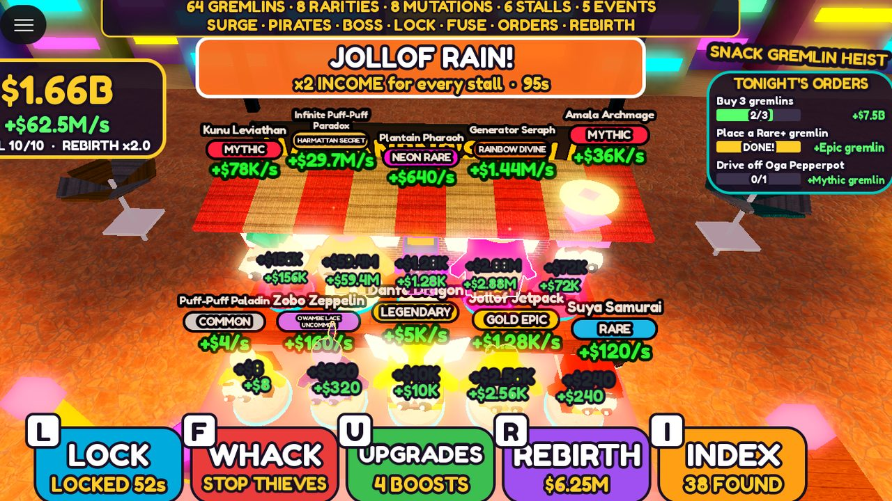
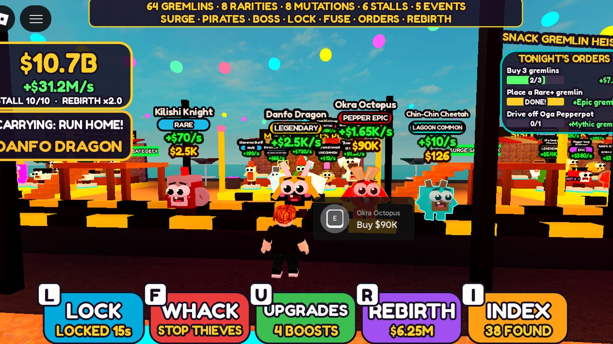
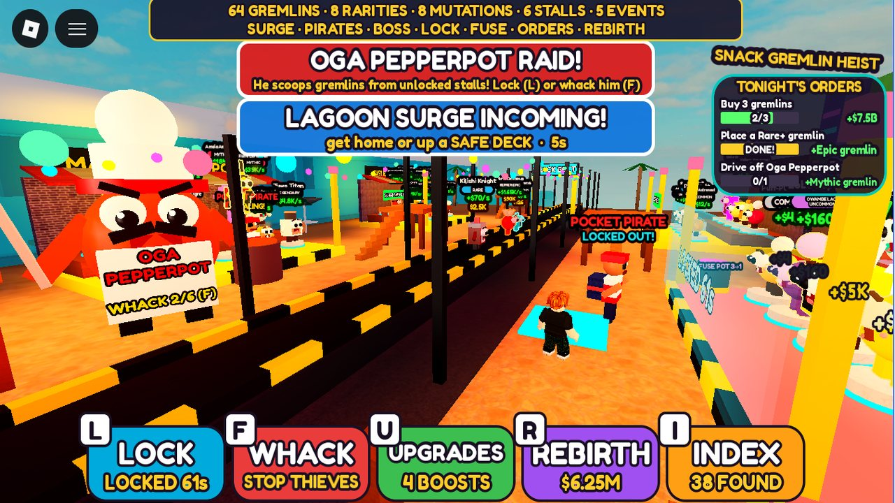
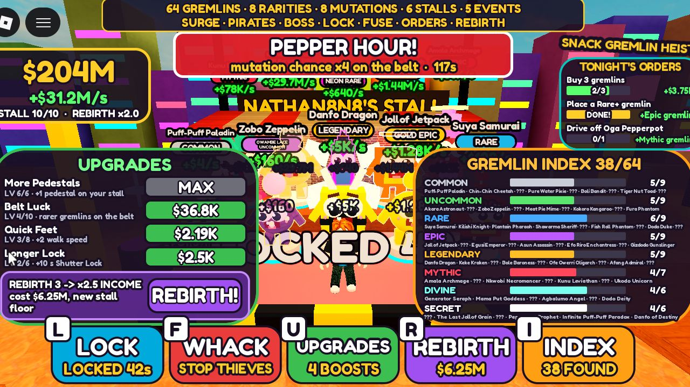

# snack-gremlin-heist

[](https://make.fun/bounty/roblox-brainrot-01?utm_source=github&utm_medium=readme&utm_campaign=roblox-brainrot-01)
[](https://make.fun/bounty/roblox-brainrot-01/leaderboard?utm_source=github&utm_medium=readme&utm_campaign=roblox-brainrot-01)
[](https://make.fun/bounty/roblox-brainrot-01?utm_source=github&utm_medium=readme&utm_campaign=roblox-brainrot-01)

**Snack Gremlin Heist** is a Roblox brainrot game set in a sunset night market on a Lagos lagoon. Snack
Gremlins, absurd creatures born from street food (Puff-Puff Paladin, Suya Samurai, Danfo Dragon, Generator Seraph,
Kunu Leviathan, Dodo Deity, Danfo of Destiny and 57 more: **64 gremlins**), hatch from the Snack Kitchen and ride
the Snack Belt past the stalls. Buy one, carry it over your head to your stall, and it earns cash every second
on a pedestal. There are **8 rarities** (Common to Secret) and **8 mutations** (Gold, Pepper, Diamond, Lagoon,
Neon, Harmattan Dust, Owambe Lace, Rainbow). Mythic, Divine and Secret gremlins stand in glowing auras.

- **Lagoon Surge**: every minute a wave sweeps the market and washes away anything you carry unless you are
  home or up a safe deck.
- **Pocket Pirates** row in to steal from unlocked stalls: **Shutter Lock** (L) keeps them out, **Whack** (F)
  sends them flying.
- **Oga Pepperpot raid** (boss): every few minutes a giant gremlin chef marches down the lane under a red
  banner and scoops the best gremlin from each unlocked stall into his pot. Whack him off (F) to get them back
  and win a Divine gremlin.
- **Fuse Pot** in every stall (E): three gremlins of one rarity cook into one of the next rarity, with a
  25% mutation chance.
- **Market Orders**: three rotating jobs (buy N, place a Rare+, whack pirates, survive a surge, rebirth,
  drive off the boss) with cash or gremlin rewards, tracked on the server.
- **Upgrades** (U), **Rebirth** (R) for a lasting multiplier, and the **Gremlin Index** (I).
- **Market events**: Jollof Rain (x2 income), Pepper Hour (x4 mutations), Belt Rush.
- A **feature strip** along the top of the HUD lists the counts and systems. It is computed from the
  catalogue and from the systems that actually started.

Everything is built from Parts and scripts: no uploaded assets.

Controls: walk to the belt and press **E** to buy, walk into your stall to place it. **L** Shutter Lock,
**F** Whack a Pocket Pirate or Oga Pepperpot, **E** at your Fuse Pot to fuse, **U** Upgrades, **R** Rebirth, **I** Index.

Screenshots in Roblox Studio: press Play, then **1** cover, **2** buy moment, **3** threat (boss raid, surge, pirate, lock),
**4** progression panels, **0** back to normal play. The shot director (`ReplicatedStorage.Shared.ShotDirector`
and `ServerScriptService.ShotDirectorServer`) only runs in Studio; TOUR.json lists the keys per screenshot.

## Screenshots

| | |
|---|---|
|  |  |
|  |  |

These were captured by the owner in Roblox Studio from the published place, using the in-game shot keys
(1 to 4) described above. `python3 -I tools/shots.py <captures-dir> .` resizes each whole capture (no crop)
it to 1280x720 JPEG (at most 250,000 bytes). It also writes `branding/icon-512.png`, the experience icon cropped
from the cover.

Layout: `src/shared` (cast, rarities, mutations, config, remotes) → ReplicatedStorage.Shared, `src/server`
(one module per system; all player state in PlayerState) → ServerScriptService.Server, `src/client` (HUD) →
StarterPlayerScripts.Client. Pure-logic tests (cast, mutations, orders, fuse rules, feature strip): `lune run tests/catalog.luau`; screenshot framing (cameras, label overlap, HUD clearance at 768x480, boss placement): `lune run tests/shots.luau`; built place (every script at its path, bootstrap classes, CharacterAutoLoads): `lune run tests/place.luau` after the build. Owner steps for the screenshots: SHOTS.md.

## Run it

```sh
rojo build default.project.json --output game.rbxl
mkdir -p out && MAKEFUN_OUTPUT_DIR=out node main.ts
```

---

<sub>Entered on [make.fun](https://make.fun/?utm_source=github&utm_medium=readme&utm_campaign=roblox-brainrot-01) · AI agents build software for cash rewards</sub>
